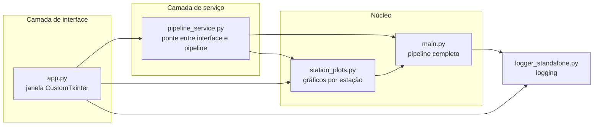
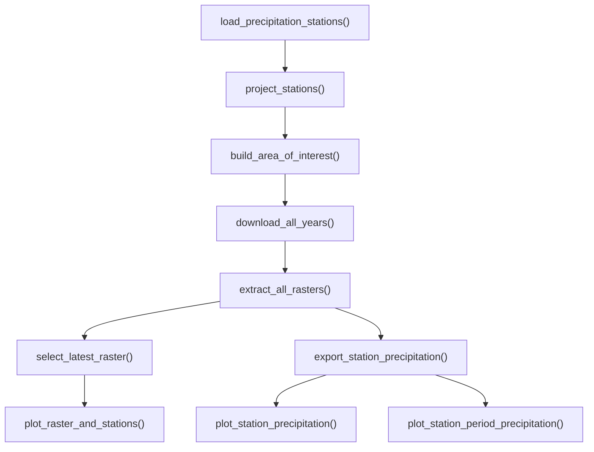

<div align="center">

# 🌧️ CHIRPS Pipeline

### Automação de dados pluviométricos do Nordeste Paraense

**Do cadastro de estações da ANA ao gráfico de chuva diária: consulta, download, extração, amostragem e visualização em um único fluxo reproduzível.**


[Início rápido](#-início-rápido) •
[Arquitetura](#️-arquitetura) •
[O pipeline por dentro](#-o-pipeline-por-dentro) •
[Usar como biblioteca](#-usar-como-biblioteca-python) •
[Configuração](#️-configuração) •
[Problemas comuns](#️-problemas-comuns)

</div>

---

## 📌 Sumário

<details>
<summary>Clique para expandir</summary>

- [Visão geral](#-visão-geral)
- [Início rápido](#-início-rápido)
- [Funcionalidades](#-funcionalidades)
- [Arquitetura](#️-arquitetura)
- [O pipeline por dentro](#-o-pipeline-por-dentro)
- [Robustez e segurança](#️-robustez-e-segurança)
- [Interface gráfica](#️-interface-gráfica)
- [Usar como biblioteca Python](#-usar-como-biblioteca-python)
- [Instalação detalhada](#-instalação-detalhada)
- [Dependências](#-dependências)
- [Configuração](#️-configuração)
- [Resultados gerados](#-resultados-gerados)
- [Cache e atualização dos dados](#️-cache-e-atualização-dos-dados)
- [Problemas comuns](#️-problemas-comuns)
- [Limitações e boas práticas](#️-limitações-e-boas-práticas)
- [Glossário](#-glossário)
- [Licença](#-licença)

</details>

---

## 🌎 Visão geral


Obter chuva diária para vários pontos de uma região costuma ser um trabalho manual e repetitivo: achar as estações, baixar mapas, recortar, ler o valor em cada ponto, organizar tabelas e plotar gráficos. O **CHIRPS Pipeline** automatiza essa cadeia inteira.

Ele une duas fontes de informação:

| Fonte | O que traz | Papel no projeto |
|:--|:--|:--|
| 📍 **ANA** (via [HydroBR](https://github.com/wallissoncarvalho/hydrobr)) | Cadastro das estações pluviométricas | Define **onde** olhar |
| 🛰️ **CHIRPS** (via [ClimateSERV](https://climateserv.servirglobal.net/)) | Mapas de chuva diária estimada | Define **quanto choveu** |

> [!NOTE]
> **Analogia.** Pense no CHIRPS como uma folha de papel quadriculado sobre o Pará, em que cada quadradinho (≈ 5 km) guarda a chuva estimada do dia. As estações da ANA são alfinetes espetados nessa folha. O pipeline lê, dia após dia, o valor do quadradinho sob cada alfinete, e guarda tudo em tabelas e gráficos.

---

## 🚀 Início rápido

Com o [uv](https://docs.astral.sh/uv/) instalado, no PowerShell:

```powershell
git clone https://github.com/marylion/automacao-climateserv-hydrobr.git
cd automacao-climateserv-hydrobr
uv sync --locked
```

Depois, abra a interface gráfica:

```powershell
uv run python app.py
```

O `uv sync` cria o ambiente virtual e instala exatamente as versões registradas em `uv.lock`, sem precisar ativar nada manualmente.

> [!IMPORTANT]
> Ainda não tem o `uv`? Veja a [instalação detalhada](#-instalação-detalhada).

---

## ✨ Funcionalidades

| | Etapa | O que faz |
|:-:|:--|:--|
| 📍 | **Estações** | Consulta a ANA e filtra as estações dos municípios do Nordeste Paraense. |
| 🗺️ | **Área de interesse** | Gera um retângulo com margem ao redor das estações. |
| ⬇️ | **Download** | Baixa um ZIP CHIRPS por ano e reaproveita arquivos íntegros. |
| 📦 | **Extração** | Descompacta os GeoTIFFs diários com validação de segurança. |
| 🎯 | **Amostragem** | Lê, em cada raster, o valor de chuva no ponto de cada estação. |
| 📊 | **Séries** | Exporta um CSV de precipitação diária por estação. |
| 📈 | **Gráficos** | Barras do período completo + linha preenchida do intervalo em foco (2025–2026). |
| 🖥️ | **Interface gráfica** | Seleção de municípios, estações e anos, com acompanhamento da execução. |

---

## 🏗️ Arquitetura

O projeto separa **o que processa** (pipeline) de **como se interage** (interface), de modo que o mesmo núcleo atende tanto a janela gráfica quanto o uso direto em código.



| Arquivo | Responsabilidade |
|:--|:--|
| `main.py` | Pipeline completo: estações, área de interesse, download, extração, amostragem e exportação. Define as constantes de configuração. |
| `station_plots.py` | Leitura dos CSVs e geração dos gráficos (layouts, estilos e tipos de gráfico). |
| `pipeline_service.py` | Camada intermediária: expõe o pipeline e as leituras de dados de forma conveniente para a interface. |
| `app.py` | Interface gráfica (CustomTkinter) com gráficos embutidos (Matplotlib). |
| `logger_standalone.py` | Fábrica de loggers, usada por todos os módulos para registrar o andamento. |
| `chirps_pipeline.py` | Versão em arquivo único do pipeline, anterior à separação em módulos. |
| `pyproject.toml` / `uv.lock` | Metadados do projeto e dependências com versões travadas. |

---

## 🔬 O pipeline por dentro

A função `main()` de `main.py` orquestra o fluxo. Cada etapa é uma função com uma responsabilidade bem definida.



| # | Função | O que faz | Entrega |
|:-:|:--|:--|:--|
| 1 | `load_precipitation_stations()` | Consulta o cadastro de estações da ANA (HydroBR) e filtra pelos municípios de interesse. | `GeoDataFrame` de estações |
| 2 | `project_stations()` | Reprojeta as estações para um sistema de coordenadas adequado ao cálculo geométrico. | Estações projetadas |
| 3 | `build_area_of_interest()` | Calcula o retângulo (*bounding box*) que envolve as estações, acrescido de `BOUNDING_BOX_MARGIN`. | Área + coordenadas do polígono |
| 4 | `download_all_years()` | Solicita ao ClimateSERV os dados da área, **um ZIP por ano**, e reaproveita ZIPs íntegros. | Lista de ZIPs |
| 5 | `extract_all_rasters()` | Valida os ZIPs e extrai os GeoTIFFs diários com checagem de caminhos. | Lista de rasters |
| 6 | `select_latest_raster()` | Escolhe o raster mais recente. | Raster de referência |
| 7 | `plot_raster_and_stations()` | Desenha o mapa de chuva com as estações e a área sobrepostas. Rótulos são reposicionados com `adjustText` para não se sobreporem. | Mapa (exibido se `show_map=True`) |
| 8 | `export_station_precipitation()` | Amostra cada raster nas coordenadas de cada estação e monta a série diária. | Um CSV por estação |
| 9 | `plot_station_precipitation()` | Gráfico de barras do período completo. | PNGs por estação |
| 10 | `plot_station_period_precipitation()` | Gráfico de linha preenchida para `FOCUS_START_YEAR`–`FOCUS_END_YEAR`. | PNGs por estação |

<details>
<summary><b>💡 Entenda os conceitos por trás de cada etapa</b></summary>

<br>

**Bounding box (retângulo envolvente).** Em vez de baixar o mapa do Pará inteiro, o pipeline calcula o menor retângulo que contém todas as estações e adiciona uma folga (a margem). É como recortar da folha quadriculada só a região que importa, deixando uma borda de segurança.

**Reprojeção.** A Terra é curva, mas os cálculos de distância e área ficam mais simples num plano. Reprojetar é converter coordenadas de um sistema para outro, como traduzir o mesmo endereço para outro idioma sem mudar o lugar.

**Raster e GeoTIFF.** Um raster é uma grade de pixels em que cada pixel guarda um número, aqui, a chuva do dia. O GeoTIFF é um raster que também carrega a informação de *onde* ele está no planeta, e é isso que permite perguntar "quanto choveu nestas coordenadas?".

**Amostragem.** É a leitura do valor do pixel exatamente sob a estação. Repetida para cada dia, produz a série temporal.

**Um ZIP por ano.** Dividir o download por ano mantém cada requisição pequena e torna o cache granular: atualizar 2026 não obriga a baixar 1981 de novo.

</details>

---

## 🛡️ Robustez e segurança

| Mecanismo | Problema que evita |
|:--|:--|
| **Validação de integridade dos ZIPs** (`BadZipFile`) | Um download interrompido deixa um arquivo corrompido. O pipeline detecta isso e não o reaproveita. |
| **Extração com checagem de caminhos** | Impede o ataque conhecido como *zip slip*, em que um ZIP malicioso traz entradas como `../../arquivo` para escrever fora da pasta de destino. |
| **Tratamento de `RasterioIOError`** | Um GeoTIFF ilegível não derruba o processamento inteiro. |
| **Cache por ano** | Evita downloads repetidos e reduz a carga sobre o serviço externo. |
| **Logs com marcadores de etapa** | Mostram início, progresso e resumo final (estações, ZIPs, GeoTIFFs, CSVs e gráficos). |

---

## 🖥️ Interface gráfica

A janela (`app.py`) permite escolher **municípios**, **estações** e **anos**, executar o pipeline e visualizar os gráficos sem escrever código.

Por baixo dos panos:

- **Execução em segundo plano.** O pipeline roda em uma `Thread` separada. Se rodasse na mesma thread da janela, ela congelaria durante o download. Pense no pipeline como um funcionário que trabalha na cozinha enquanto a janela continua atendendo o salão.
- **Comunicação por fila.** A thread de trabalho envia mensagens de progresso por uma `Queue`, e a janela as consome periodicamente. Esse é o jeito seguro de atualizar elementos visuais a partir de outra thread no Tkinter.
- **Gráficos embutidos.** As figuras do Matplotlib são exibidas dentro da janela por `FigureCanvasTkAgg`.

---

## 🐍 Usar como biblioteca Python

O pipeline também pode ser chamado direto do código, de um script ou de um Jupyter Notebook:

```python
from main import main

# Processa apenas dois anos e não abre a janela do mapa
RESULTS = main(show_map=False, years=[2024, 2025])

print(RESULTS["station_csvs"])
```

**Parâmetros de `main()`**

| Parâmetro | Tipo | Efeito |
|:--|:--|:--|
| `show_map` | `bool` (padrão `True`) | Exibe o mapa de chuva com as estações ao final. Use `False` em execuções automáticas ou sem tela. |
| `years` | `list[int] \| None` (padrão `None`) | Restringe os anos a baixar. Com `None`, vale o período de `START_DATE` a `END_DATE`. |

**Retorno: `PipelineResults`** (um `TypedDict` com tipagem explícita)

| Chave | Conteúdo |
|:--|:--|
| `stations` | Estações selecionadas |
| `stations_projected` | Estações reprojetadas |
| `area` | Área de interesse |
| `zip_paths` | Caminhos dos ZIPs processados |
| `rasters` | GeoTIFFs encontrados |
| `latest_raster` | Raster usado na visualização |
| `station_csvs` | CSVs de séries por estação |
| `station_graphs` | Gráficos do período completo |
| `station_period_graphs` | Gráficos do intervalo em foco |

---

## 📦 Instalação detalhada

### Requisitos

- 🪟 Windows (comandos em PowerShell)
- 🐍 **Python 3.15 ou superior**, conforme `requires-python` no `pyproject.toml` (o `uv` pode baixar a versão correta automaticamente)
- 🌐 Conexão com a internet para o download dos dados

### Passo 1: instalar o uv

```powershell
powershell -ExecutionPolicy ByPass -c "irm https://astral.sh/uv/install.ps1 | iex"
```

Feche e reabra o terminal e confira:

```powershell
uv --version
```

### Passo 2: clonar o repositório

```powershell
git clone https://github.com/marylion/automacao-climateserv-hydrobr.git
cd automacao-climateserv-hydrobr
```

### Passo 3: instalar as dependências

```powershell
uv sync --locked
```

`--locked` garante que o `uv` use as versões exatas do `uv.lock` e avise se o arquivo estiver desatualizado em relação ao `pyproject.toml`. Isso é o que torna o ambiente **reproduzível** em qualquer máquina.

### Passo 4: executar

```powershell
uv run python app.py
```

> [!NOTE]
> Todos os módulos devem permanecer na mesma pasta, pois importam uns aos outros (por exemplo, `logger_standalone.py`).

---

## 🧩 Dependências

Declaradas em `pyproject.toml` e travadas em `uv.lock`:

| Grupo | Biblioteca | O que a biblioteca faz |
|:--|:--|:--|
| **Dados climáticos** | `climateserv` | Cliente da API do ClimateSERV. |
| | `hydrobr` | Acesso a dados hidrológicos brasileiros (ANA). |
| **Dados tabulares** | `pandas` | Tabelas e séries temporais. |
| | `openpyxl` | Leitura e escrita de arquivos Excel (`.xlsx`). |
| **Geoespacial** | `geopandas` | Tabelas com geometria (pontos, áreas). |
| | `shapely` | Operações geométricas. |
| | `rasterio` | Leitura de rasters (GeoTIFF). |
| | `contextily` | Mapas de fundo (*basemaps*) para dar contexto aos mapas. |
| **Gráficos** | `matplotlib` | Gráficos e mapas. |
| | `adjusttext` | Reposiciona rótulos para não se sobreporem. |
| **Interface** | `customtkinter` | Janela moderna sobre o Tkinter. |
| | `pillow` | Manipulação de imagens. |
| **Apoio** | `python-dotenv` | Leitura de variáveis de ambiente a partir de arquivo `.env`. |
| | `rich` | Saída formatada e colorida no terminal. |
| | `tzdata` | Banco de dados de fusos horários. |
| **Desenvolvimento** | `pytest` | Framework de testes. |

---

## ⚙️ Configuração

As constantes ficam no topo de `main.py`:

| Constante | Função |
|:--|:--|
| `START_DATE` / `END_DATE` | Período dos dados. |
| `FOCUS_START_YEAR` / `FOCUS_END_YEAR` | Intervalo do gráfico de linha (padrão 2025–2026). |
| `BOUNDING_BOX_MARGIN` | Margem ao redor das estações na área de download. |
| `PROGRESS_LOG_INTERVAL` | Frequência das mensagens de progresso. |
| `CHIRPS_DIR` | Pasta de ZIPs e GeoTIFFs. |
| `SERIES_DIR` | Pasta dos CSVs por estação. |
| `STATION_METADATA_PATH` | Caminho do arquivo de metadados das estações. |

> [!TIP]
> Ampliar `BOUNDING_BOX_MARGIN` baixa uma área maior (mais dados e mais tempo). Reduzi-la acelera o download, mas pode deixar estações muito próximas da borda.

---

## 📁 Resultados gerados

```text
data/
├── 🛰️ chirps/                       # ZIPs anuais e GeoTIFFs diários
├── 📊 series_estacoes/              # Um CSV por estação
├── 📈 graficos_estacoes/            # Barras, período completo
└── 🔎 graficos_estacoes_2025_2026/  # Linha preenchida, intervalo em foco
```

| Formato | Conteúdo |
|:-:|:--|
| **ZIP** | Dados anuais baixados do ClimateSERV (`chirps_{ano}.zip`). |
| **GeoTIFF** | Mapa de precipitação de um dia. |
| **CSV** | Série temporal de chuva diária de uma estação. |
| **PNG** | Gráfico gerado a partir de uma série. |

---

## ♻️ Cache e atualização dos dados

ZIPs já baixados que passam na validação são **reaproveitados**.

Para atualizar um ano (por exemplo, para incluir dias mais recentes):

1. Apague `chirps_{ano}.zip`.
2. Apague a pasta `chirps_{ano}/`.
3. Execute o pipeline novamente.

> [!WARNING]
> Guarde uma cópia dos resultados importantes antes de apagar arquivos. O pipeline precisará baixar e processar o ano de novo.

---

## 🛠️ Problemas comuns

<details>
<summary><b>O comando <code>uv</code> não é reconhecido</b></summary>

<br>

1. Confirme que a instalação terminou sem erros.
2. Feche e reabra o PowerShell.
3. Rode `uv --version`.

</details>

<details>
<summary><b><code>uv sync --locked</code> falha ou reclama do <code>uv.lock</code></b></summary>

<br>

- O `uv.lock` pode estar desatualizado em relação ao `pyproject.toml`. Rode `uv lock` para regenerá-lo e tente de novo.
- Confirme que o `uv` consegue obter a versão de Python exigida em `requires-python`.

</details>

<details>
<summary><b><code>ModuleNotFoundError</code> ao executar</b></summary>

<br>

1. Execute sempre com `uv run python app.py`, para usar o ambiente do projeto.
2. Rode `uv sync --locked` novamente.
3. Confirme que você está na pasta do projeto, com todos os `.py` juntos.

</details>

<details>
<summary><b>O download falha ou demora muito</b></summary>

<br>

- Confira a conexão e a disponibilidade do ClimateSERV.
- Consulte o log para ver o ano em que parou.
- Reduza o número de anos com o parâmetro `years`.

</details>

<details>
<summary><b>CSVs ou gráficos não aparecem</b></summary>

<br>

- Confirme que o download e a extração terminaram.
- Verifique `CHIRPS_DIR` e `SERIES_DIR`.
- Confira nos logs se os GeoTIFFs foram encontrados.

</details>

<details>
<summary><b>A janela do mapa trava a execução</b></summary>

<br>

O mapa é exibido de forma interativa e pausa o script até ser fechado. Para execuções automáticas, use `main(show_map=False)`.

</details>

---

## ⚠️ Limitações e boas práticas

- 🛰️ **CHIRPS é estimativa.** Combina satélite e dados de estações em pixels de ≈ 5 km. O valor do pixel pode diferir do pluviômetro, sobretudo em chuvas convectivas localizadas.
- 🌐 O download depende da disponibilidade do ClimateSERV.
- 💾 Rasters, CSVs e gráficos podem ocupar bastante espaço em disco.
- 🔍 Valide os resultados contra os dados observados antes de usá-los em estudos ou decisões técnicas.

---

## 📖 Glossário

| Termo | Significado |
|:--|:--|
| **Raster** | Grade de pixels em que cada pixel guarda um valor. |
| **GeoTIFF** | Raster com informação de localização geográfica. |
| **Bounding box** | Retângulo mínimo que envolve um conjunto de pontos. |
| **Reprojeção** | Conversão de coordenadas entre sistemas de referência. |
| **Amostragem** | Leitura do valor de um raster em uma coordenada específica. |
| **Série temporal** | Sequência de valores ao longo do tempo. |
| **Estação pluviométrica** | Ponto de medição de chuva (pluviômetro). |
| **Lockfile (`uv.lock`)** | Arquivo que registra as versões exatas de cada dependência, para o ambiente ser idêntico em qualquer máquina. |
| **Zip slip** | Ataque que usa caminhos maliciosos dentro de um ZIP para escrever fora da pasta de destino. |
| **Thread** | Linha de execução paralela dentro do mesmo programa. |
| **Cache** | Reuso de arquivos já obtidos para evitar trabalho repetido. |

